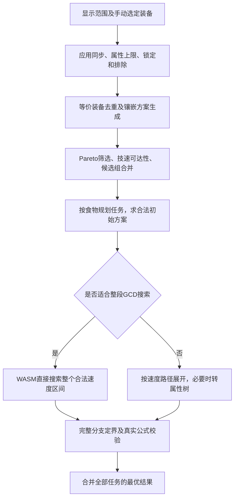

# 自动配装算法总览与优化去留

当前决定（2026-10-30）：梯度细化及继承实验已因收益有限[归档](optimizer-gradient-archive.md)，停止当前推进；原生静态线性上界继续使用。

最新源码流程见[当前自动配装算法](optimizer-current-algorithm.md)。本页组件状态和耗时按各段冻结版本解读；当前工作区的候选共享／重启已接线启用，不等于本页旧基线使用了同样配置。

> 当前决定（2026-10-30）：HiGHS 已退出当前求解、验证和基准流程，仅作为[未来可选项](optimizer-highs-future-option.md)归档。下文接入状态、命令与测量属于历史研究记录。

后续实验：新增[整数目标与舍入误差恢复](optimizer-integer-objective-recovery.md)，以新的模型和真实浏览器测量重新验证两个慢例。下文旧浮点整数模型的失败结论仍保留；新方案尚未接入网页或部署。

全面复测更新：整数模型已复现浏览器错误Optimal，当前不通过采用门槛。本文整数模型耗时属于历史实验，不能继续作为可替换默认算法的证据；原生算法的独立重新对照见[复测报告](optimizer-algorithm-retest.md)。

本报告以工作区 `a590b92` 的已提交算法、当前未提交改动及现有完整实验记录为准。本轮已对当前原生组合开展独立完整复测及移除对照；历史版本不再冒充当前结果，没有部署或删除默认算法。最新数据统一以[复测报告](optimizer-algorithm-retest.md)为准。

判断最终组合的组件去留时，优先查阅[算法—案例证据台账](optimizer-case-dependencies.md)。本文的历史收益不自动表示该算法在最新组合中仍是关键组件。

## 1. 当前实际有几个版本

| 位置 | 状态与内容 |
| --- | --- |
| 发布分支的正式页资产 | WASM 为 ABI 6，哈希与本地 `d6ce921`、`1d96454` 的内核相同；不能把之后的 ABI 11 优化算作已经上线 |
| 发布分支的 preview 资产 | WASM 为 ABI 7，哈希匹配 `29a044a`；发布记录也标明该预览来源 |
| 当前已提交源码 | WASM ABI 11。包含坦克整段 GCD 路径、最低坚韧预算、完整搜索的约束索引与排序等后续优化；没有启用迭代梯度原型 |
| 当前未提交工作区 | 有中间候选发布、Worker 协调器及自动重启的接线。自动重启仍是未采纳的实验，不能因它留在工作区就视作性能验收通过 |
| HiGHS 整数模型 | 已退出当前流程；源码和实验数据归档为未来可选项，未接入网页或发布 |

发布分支头为 `7139a9a14298`。上述版本核对基于从 GitHub 下载资产后的 SHA-256，不是本地旧分支缓存；只核实内核资产，不把它当作网页 JS 全部功能或 CDN 浏览器运行的证明。见[核对记录](benchmarks/algorithm-deployment-audit.json)。

## 2. 已提交默认算法如何运行

### 2.1 输入、评分与候选范围

- 装备来自页面实际显示范围：装等限制内，加用户手动选定并保留显示的装备。没有“同步后够好就自动加入范围外装备”的额外入口。手动选定与锁定是两回事。
- 同步装备按同步后属性求解，不能使用魔晶石；非同步装备按合法孔位、等级及各属性上限生成镶嵌方案。保留合法低品级装备，是正确性要求，不是提速优化。
- 戒指同时处理两枚、唯一装备限制、重复佩戴及分别锁定；这些规则不能为提速删除。
- 无暴击偏好时最大化期望伤害；高/低暴击先计算可行暴击端点，再分别限制到最高/最低四分之一区间，区间内仍最大化伤害。这不是完整的职业技能或循环收益模拟。
- 最低坚韧减伤是硬约束；减伤换伤害是互斥的排序目标：`score = damage × (1 + max(0, mitigation) / X)`，其中 mitigation 用比例、X 用输入框百分数数值。实际伤害与折算评分分开返回。
- 自动食物当前仍只取标记为 best、非 PIE 的最高品级候选，手动锁定另行处理。因此这里的“精确最优”是给定装备、食物、镶嵌及评分规则下的最优，不是游戏全部食物的无条件最优。

### 2.2 搜索前压缩

| 机制 | 实际作用 | 保留依据 |
| --- | --- | --- |
| 等价装备先去重 | 同步后完全相同的装备先合并，减少重复镶嵌展开；戒指保留必要的不同 ID | 不改变可达属性与唯一装备规则 |
| 镶嵌属性签名去重 | 多种镶嵌产生相同有效属性时只保留代表 | 消除重复属性状态；不是只保留某几种魔晶石 |
| Pareto 支配筛选 | 同速度下，各评分属性均不更好的选择可以被替代 | 高暴击可跨 CRT 支配；低暴击有上限，须保护相同 CRT 分组 |
| 冗余速度石替换 | 替换后仍在目标 GCD 档，且不破坏暴击约束时排除冗余方案 | 有明确可替代方案才删除；只有 CRT/速度可选等情形仍保守处理 |
| 技速可达性与路径 DP | 检查各组组合后还能否达到目标，缓存剩余可达速度、预算与 CRT 下界 | 已有默认算法就包含这类离散可达性处理，不是最近才想到 DP |
| 候选组收缩 | 将部分部位组合后再次去重/支配筛选，减少后续维数 | 有组合量、结果规模及压缩率门槛，防止合并本身失控 |

当前收缩最多7轮；候选乘积超过25万不尝试合并，合并结果超过10万或压缩不明显则放弃。它不是无限展开所有装备组合。

### 2.3 精确搜索、上界与初始解

主算法是分支定界，不是逐套装备的简单穷举。小规模阶段保留必要状态；预计下一轮 Map 展开过大时切换属性树，避免 `Map maximum size exceeded`，不截断候选冒充精确结果。

树搜索同时使用以下信息：

1. 技速范围、暴击范围及最大坚韧等必要条件。
2. 各属性独立最大值给出的乐观伤害。
3. 副属性总预算，扣除必需技速，并为最低减伤预留坚韧。
4. 在真实候选上计算的相关线性上界，保留属性之间的取舍。
5. 主属性/武器已经确定时的精确取整因子。

有效上界取更小者；只有整棵必要搜索完成才证明最优。暴击区间划分覆盖整个有效域，包括相邻边界，最终叶节点仍用真实食物、取整、GCD及减伤公式检查。

这里本来就有解析切线及上界，不能把后续未采用的“多轮 Frank–Wolfe 梯度细化”与所有切线上界混为一谈。当前默认内核不在每个子树重新做梯度或张量优化。

先用贪心、合法暴击端点及有预算的两部位替换寻找更强初始解。预热负责尽快找好解，完整搜索负责证明，两者保留不同的访问顺序；不能把有步数上限的预热当作最优证明。

### 2.4 树序、运行时与调度

- 优先区分武器伤害和主属性，物理与魔法使用各自正确的武器轴。
- 正的最低减伤要求下，完整搜索按 TEN 建索引；再按 TEN、CRT、速度的约束余量选择更值得拆开的组。
- 大型适用任务直接搜索整个 GCD 区间，避免反复枚举速度路径、打包和调用后端。坦克身份排除已经删除；仍保留工作量、后端能力等条件，青魔整段入口的排除尚未正式解除。
- WASM负责热点搜索及大集合Pareto；JS保留规划、组织与回退，小集合也不强制跨后端调用。JS回退正确，但部分最新坚韧上界仅在C内核中更强，速度不能视为与WASM相同。
- Worker按食物、速度或候选分片并行；分片可以缓解负载不均，但增加分片也可能重复准备和查询，不是越多越好。
- 复用路径数组、属性缓冲区、根指针和上界缓存，减少分配、GC与重复计算。还修复过重复原生查询导致的内存增长。

## 3. 哪些改动有较大收益

下表每一行都使用其自身实验的基线和输入。不能将各行百分比相加，也不能当成今天对所有版本重新测出的统一排行榜。

| 改动 | 有证据的场景及结果 | 结论 |
| --- | --- | --- |
| WASM Pareto＋最终搜索 | 早期固定中等任务：JS18.470秒→组合5.852秒；仅Pareto8.090秒，仅最终搜索15.465秒 | 两部分都有增量价值；当时Pareto收益更大 |
| 武器/主属性树序＋相关上界 | 同87件战士375、GCD2.50：旧版超过120秒；仅树序27.985秒；组合复测约5.9–6.8秒 | 两项都是明显有效的优化 |
| 冗余速度镶嵌剪枝 | 同一旧暴击半区规则：战士高暴击32.085→14.190秒，低暴击38.017→约13.8秒 | 保留，确有单项收益 |
| 高暴击恢复跨CRT支配 | 在上项基础上高暴击14.190→约7.0–7.3秒 | 原先保护过度，可安全删去多余保护；低暴击不能照搬 |
| 非坦克预算界 | 武僧固定4个慢任务：旧版超过600秒，新版9.653/10.299秒 | 局部证据很强，但不是整个输入600→10秒 |
| 速度前缀剪枝＋缓冲复用 | 同一个武僧慢分片：超过180秒→61.625秒；Node单项也有增量对照 | 保留；这是局部分片证据 |
| 整段GCD搜索＋合法种子改进 | 武僧1.94高暴击：带相同已知下界的完整配对2775.072→234.081秒；后续冷启动约163秒 | 大幅减少重复查询；种子与区间路径须共同评价 |
| 坦克进入公共区间路径 | 战士2.48、无最低减伤81.14→8.38秒，分片184→6 | 坦克专属排除没有必要；最低减伤预算/评分约束须同时补齐 |
| 迭代梯度细化（未采用原型） | 统一坦克路径之前，武僧1.93约1333.92→155.05秒，不限暴击1.94约162.22→44.60秒 | 特定长例收益很大；同一原型有明确回退，不能推广为全局默认 |
| TEN索引＋约束压力排序，保留原预热 | 战士2.50最低10%三轮中位数16.92→5.16秒；最低20%约76.12→5.77秒 | 两项各有单项证据，组合满足门槛；不按职业或某个减伤数值开关 |
| 装备与魔晶石分开整数建模（本实现已否决） | 历史部分案例较快，但本轮武僧1.93浏览器报告Optimal却返回较差结果 | 不通过正确性门槛，不能以历史耗时决定采用 |

高/低暴击取外侧四分之一区间也带来大幅改善：武僧低暴击785.515→32.884秒，高暴击156.449→39.662秒。但它改变了用户约束，**不是同一数学问题下的纯算法提速**；这例最优值刚好不变，不保证其他输入也不变。

主要证据：[早期逐项验证](optimizer-performance.md)、[树序与相关界](optimizer-search-acceleration.md)、[暴击剪枝](optimizer-critical-pruning.md)、[武僧区间](optimizer-monk-605-interval.md)、[坦克区间](optimizer-tank-interval.md)、[最低坚韧](optimizer-minimum-tenacity-search.md)、[偏好规则调整](optimizer-critical-quarters.md)。

## 4. 整数模型的历史实验与本轮否决

最初的整数模型仍把完整镶嵌方案当作变量。最新原型把装备选择作为0/1变量、各等级魔晶石分配作为整数数量，并精确表达属性封顶、锁定和戒指约束；伤害仍为真实档位查询表。骑士圆蛤羹分片总变量数2868→1497。

它仍使用HiGHS内部的分支定界，上界没有消失；主要新价值是改变离散决策表示。前处理目前仍复用原候选展开，尚未彻底消除这部分成本。

下表为之前保存的历史数据。虽然这些案例当时与参考值相符，但同一实现已在另一个真实浏览器案例失败；表中耗时不再作为采用或组件去留的依据。均不限暴击、4 Workers、包含规划及全部分片。

| 输入 | 已提交原生内核的记录 | 最初整数模型 | 最新装备/魔晶石拆分模型 |
| --- | --- | --- | --- |
| 骑士605／580–605／2.45／最低10% | 超过300秒 | 一次272.118秒，后续变体仍超时 | 65.426秒；独立入口复跑68.101秒 |
| 战士375／350–375／2.48／最低15% | 超过300秒 | 49.123秒，复跑51.222秒 | 31.895秒 |
| 骑士605／2.45／最低15% | 42.696秒 | 没有同口径完整记录 | 41.500秒，基本持平 |
| 战士375／2.48／最低10% | 88.286秒 | 没有同口径完整记录 | 23.078秒，明显改善 |
| 画家375／幻武／2.50 | 本轮复测2.802秒 | 没有同口径完整记录 | 6.541秒，增加约3.7秒启动成本 |
| 武僧605／1.94三种暴击模式及1.93 | 本轮已重新完整运行原生对照 | 无相同口径记录 | 本轮已测；1.93暴露错误Optimal，否决当前模型 |

900个小规模对照及加入真实案例后的Node测试曾通过，但浏览器完整案例仍出现错误Optimal。这些通过记录不足以证明实现正确，也不能再用“已过900例”作为采用依据。反例、实际浏览器模型及诊断记录见[回归归档](benchmarks/integer-mnk193-regression.json)。

本轮已补测真实武僧1.94三种模式及1.93。1.93暴露的错误未被修复，因此停止该模型后续性能消融，不接入默认内核。曾计划的精简规划、范围直构造、目标门槛及分片消融均不能绕过正确性门槛；没有继续运行的项目记为被正确性阻塞，不能写成已证明无用。

详见[最新完整实验](optimizer-direct-materia-experiment.md)及[原始结果与配装校验](experiments/direct-materia-results.json)。

## 5. 哪些可以删，哪些只能说“未证明值得保留”

### 5.1 已能明确去掉的冗余或错误分流

| 项目 | 依据及适用边界 |
| --- | --- |
| 坦克身份决定不走整段GCD | 没有数学必要；已用公共路径和约束参数替代，完整对照支持收益 |
| 高暴击求解阶段仍按相同CRT分组保护所有候选 | 更高CRT不会违反高暴击下限；该保护冗余。端点计算及低暴击上限仍有不同要求 |
| 使用单独的隐藏同步候选范围 | 与显示范围加手动选定的规则冲突，已删除；不能为了减少搜索而删掉范围内有用的低品级装备 |
| 不限暴击再重复比较同一个贪心种子 | 初始方案已经来自该贪心，没有产生新方案；不等于整个有界两部位预热无用 |
| 把完整证明阶段的新索引/排序也强加给有限预热 | 会削弱有限预算找到的下界；20%例曾退化至约177–182秒，恢复原预热后排序单项约9.88秒。应保留阶段职责区分 |

### 5.2 现有实验足以否决采用，但不能证明该方向永远无用

| 方案 | 已测影响 | 当前去留 |
| --- | --- | --- |
| 全局多轮梯度细化 | 武僧不限、1.93等长例大幅受益；战士及部分高低暴击退化。统一坦克路径后仍有最低10%约15.4→52.1秒的可重复回退 | 不全局启用；单个长例收益不足以覆盖所有明确回退 |
| 梯度额外生成整数顶点种子 | 初期6例仅上界与上界＋种子分支数一致，却承担额外求解成本 | 该种子生成方式无已证实增量价值；不否定现有合法贪心/两部位预热 |
| 随梯度同时修改分裂权重 | 战士最低10%的四组消融中，只改权重15.14→16.05秒，分支完全相同；只改上界与两者都改的分支也完全相同 | 在该例中没有减少搜索量，不应将其当成必要的梯度配套；不否定原有武器/主属性优先策略 |
| 每个子树重算梯度/张量 | 武僧每区间一次初始切线59.70秒，追加局部重算56.96秒；其他例无稳定增量，且会挤占预算和增加缓存 | 不能把主要收益归给局部重算，未采用额外复杂度 |
| 只提高根部联合LP求价精度 | 根上界几乎到离线LP证书，两个目标超时例仍没解决；有些较快例改善，但增加单节点成本或搜索分支 | 暂不采用，更准确的根上界不保证整棵树更快 |
| 节点属性下界、额外资源价格、约束传播 | 部分有帮助；在最终TEN索引＋排序基础上边际收益很小，未满足组合采用依据 | 不叠加进最终默认内核；不能说必要条件本身错误 |
| 原生热点缓存＋小尾部精确枚举 | 若干完整骑士变体约195–226秒完成，战士仍300秒未完成 | 局部改善存在，但不能当作解决了两例；未采用该组合 |
| 发布新候选后终止并重启其他Worker | 新拆分模型的骑士两次约99.7/100.2秒；关闭重启65.4/68.1秒 | 这是被否决模型的历史配对，不用于当前默认去留。当前原生的共享＋重启组合已另行复测 |
| 先原生试探再交给最初整数模型 | 更早找到骑士正确最好值，仍300秒仅完成5/6 | 旧组合没有解决最终证明；未对最新拆分模型作同样完整消融 |
| 先LP收紧属性范围 | 骑士300秒仍5/6 | 未采用 |
| 根部技速＋坚韧DP预过滤 | 食物49248下骑士1966→1966，战士2573→1972，约2–12毫秒 | 根部过滤没解决骑士；未证明端到端增量，不并入新模型。不等于现有技速DP无用 |
| 仅增加候选分片 | 两例拆成18任务，150秒仍未完成；任务划分与树、种子均发生变化 | 无达标完整证据；不据此证明所有分片都无用 |

原生热点/尾部实验的完整状态补充归档于[记录](experiments/native-tail-algorithm-audit.json)。其他原始对照见[梯度归因](optimizer-gradient-causal-analysis.md)、[统一后复测](optimizer-gradient-current-unified.md)、[局部重算消融](optimizer-subtree-gradient.md)、[联合价格](optimizer-joint-constraint-runtime.md)、[超时剖析](optimizer-timeout-profile.md)及[第一轮整数模型](optimizer-integer-model-experiment.md)。

### 5.3 不能因为单项收益小就删除的部分

- **副属性预算界**：早期某例只有约3%提速，但后续武僧固定任务显示极大价值，是基础构件；不同输入、版本的结论不能互相替代。
- **合法种子**：旧梯度种子没收益，不代表强初始方案不重要。预热顺序回归和武僧区间对照均证明它会显著影响证明工作量。
- **JS回退、整数取整、封顶、锁定、唯一戒指检查**：承担兼容或正确性，不以“是否单独提速50%”决定删除。
- **食物/青魔/非正因子的保护条件**：有的是数学前提，有的是验证遗留；需要逐一证明和实测，不能一次删掉所有if。
- **UI状态保持、进度和日志**：是体验或可观测性改进，不冒充求解提速，也不因没有提速就算多余。
- **独立最优值回归与候选重建**：归一化、目标缩放及严格容差没有保证当前整数实现正确；不能把某项数值处理本身称为充分的正确性保证。

## 6. 建议保留的算法结构

1. 共享输入、真实评分、锁定/排除、同步及戒指规则，避免不同求解器维护不同的配装语义。规则必须保留，不意味着旧实现与新实现需要重复存在。
2. 将已有安全压缩、技速可达性、WASM热点和精确搜索作为已验证的比较基线；是否进入最终组合，仍须按下一节验证其在新求解结构上的剩余价值，不能凭历史收益自动永久保留。
3. 当前整数实现因浏览器错误Optimal被否决。该建模方向保留为研究材料，先修复并重过真实浏览器回归，之后才重新开展性能验收；不按职业名称掩盖失败。
4. 不将迭代梯度、逐子树重算、根LP价格、Worker重启等所有原型叠加到同一默认路径。每项需证明在选定结构上的独立或边际价值。
5. 整理工作区时，未通过采用的接线应与已验证算法分开提交；当前保留的实验文件不代表建议全部合并或发布。

采用门槛继续按同一输入、相同Worker数、完整任务耗时判断。超过300秒只提供旧耗时下限；分支减少、LP上界变紧、中间找到更好配装，都不能替代完整任务的加速证据。规则修改、候选范围变化、固定分片实验和真实整轮也分别列示。

## 7. B出现之后，重新判断A是否还有必要

历史上A优于原版，不能证明A仍属于最好的最终实现。B可能已经消除A针对的瓶颈，甚至让A成为额外开销。因此上文“有过明显收益”与“最终必须保留”是两种不同结论。

对同一组案例，应区分四种构建：原版、仅A、仅B、A+B。评价A是否留在新版本，关键是比较 **仅B与A+B**，而不是重复引用原版与仅A的差距。整个组合是否满足50%采用门槛，与其中每个零件是否还有边际价值，也分别判断。

| 旧机制A | 新结构B下的实际状态 | 目前能下的结论 |
| --- | --- | --- |
| 旧C搜索的属性树、TEN索引、分裂顺序及相关上界 | 新整数Worker不调用这套最终树搜索；原Planner仍可能调用原生算法产生种子 | 它们不是新整数求解阶段的必需配件；不能把旧收益当作需要往B中移植的理由。若仍保留旧后端，应在该后端的用途上单独评价 |
| 旧速度路径枚举及专用缓冲优化 | 整段GCD路径已绕过大量枚举，新整数求解也不沿用旧速度路径递归 | 历史固定速度分片收益不能证明它对新主路径仍有收益；旧回退路径是否继续需要，另行判断 |
| 原有镶嵌展开与Pareto | 整数模型的候选适配器仍执行它们，以取得ID、锁定和属性范围，但模型本身已经按魔晶石数量决策 | 存在值得检查的重复前处理；本轮在被否决模型上做过初步移除，但性能结论被正确性阻塞；不能提前宣布必需或可删 |
| 原Planner的合法种子与预热 | 当前整数模型计时仍包含这些步骤，种子用于全局门槛 | 65–68秒是被否决模型的历史数据，不能用于决定预热去留；当前原生预热另有本轮移除对照 |
| 自动传播候选并重启分片 | 可与新整数模型组合，也已测试关闭 | 历史有B+A约99.7/100.2秒、B约65.4/68.1秒的配对；模型已因正确性否决，不据此决定当前默认组件去留 |

后续清理应以最终候选组合为起点，逐项移除旧优化，再重测正确性、完整耗时和资源开销。删除一项后，需要在新的组合上继续判断其他项；两项优化可能互相替代，不能因为分别删除都没影响就同时删光。对交互明显的小组再做组合消融。

若A在新组合上没有可测收益、B已覆盖其适用案例，又没有其他必要职责，则优先删除A，减少代码、参数、缓存及维护成本。若只是缺少对照，应标为“待验证剩余价值”，不能继续列为默认必须保留。

本轮新增的完整复测和组合消融见[当前报告](optimizer-algorithm-retest.md)。未完成及被正确性阻塞的项目分别记录；没有改动或删除默认求解器。
