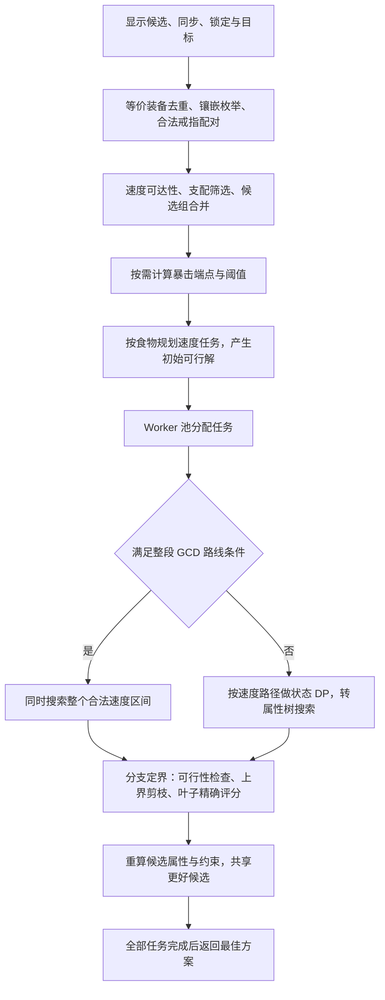

# 当前自动配装算法

梯度细化方案已按用户决定[归档](optimizer-gradient-archive.md)，不再作为当前采用候选推进。当前原生算法已有的静态线性上界继续使用。

核对日期：2026-10-30。本文描述当前工作区源码，包括未提交的 Worker 协调器；不代表发布页已部署该版本。HiGHS 及额外证书搜索已退出当前流程，见[未来可选项记录](optimizer-highs-future-option.md)。

当前主算法是**离散候选压缩＋动态规划＋分支定界**。Web Worker 负责调度，WASM 负责加速部分计算。线性松弛只用于计算剪枝上界；没有用梯度下降直接替代完整离散搜索。

## 1. 实际求解的问题

| 项目 | 当前规则 |
| --- | --- |
| 装备范围 | 以页面 `filteredIds` 为准，再应用职业、部位、排除和锁定条件；包含页面保留的手动选择项，不主动扩展到范围外 |
| 自定义武器 | 使用已配置的属性；未配置属性的自定义装备不自动尝试分配 |
| 同步装备 | 先应用同步属性上限，不生成魔晶石孔位 |
| 未锁定镶嵌 | 每孔采用该孔允许的最高等级／数值，遍历职业允许的副属性；不是遍历所有等级或所有空孔方案 |
| 锁定镶嵌 | 按用户锁定的具体镶嵌保留 |
| 食物 | 未锁定时，选择适用职业、标记 best、无信仰的最高品级食物，并按效果去重；不是全游戏所有食物 |
| GCD | 必须落在指定的两位小数 GCD 档，包含食物和职业修正；不是越快越好 |
| 默认目标 | 最大化每威力伤害期望，不模拟完整职业循环 |
| 最低坚韧 | 满足最低坚韧减伤后，最大化伤害 |
| 坚韧折算 | 与最低减伤模式互斥；最大化 `damage × (1 + max(0, mitigation) / X)`，其中 mitigation 用比例，X 为“每 1% 伤害对应的减伤百分点”输入值 |
| 高／低暴击 | 在满足 GCD 和硬约束的候选域内求最终暴击最小值 L、最大值 H；高暴击要求 `CRT ≥ L + 0.75(H−L)`，低暴击要求 `CRT ≤ L + 0.25(H−L)`；域内仍最大化上述目标 |

“最优”的范围受这些候选和评分规则限定。低暴击不是直接最大化信念、直击，也没有改变伤害公式。

入口：[输入构造](../src/optimizerInput.ts)、[目标与搜索](../src/optimizer.ts)。`optimizerCandidateFallbacks.ts` 中旧的向下扩候选辅助函数目前没有被生产输入构造调用，不能继续把它描述为当前候选流程。

## 2. 从输入到结果

图展示逻辑依赖；实现中暴击端点在全局规划时先用受保护的候选域计算，各食物与各 Worker 会重新构造所需候选和索引，并非全程只预处理一次。

## 3. 搜索前如何缩小问题

1. **等价装备归并。** 同属性、上限、孔位和唯一性语义的装备保留代表。戒指保留必要的两个 ID，锁定 ID 保留。
2. **单件镶嵌枚举并去重。** 逐孔分配属性、应用封顶；有效属性相同的不同镶嵌只留一份。
3. **戒指先配对。** 两枚戒指形成一个候选组，先处理唯一品、可重复佩戴和两侧锁定，再搜索其他部位。
4. **支配筛选（Pareto）。** 同速度下，一个方案各评分属性都不如另一个时可以淘汰。低暴击存在暴击上限，因此额外按相同 CRT 分桶；计算暴击端点时也保护 CRT，不用“暴击更高”直接淘汰较低方案。
5. **速度动态规划。** 正向计算可达速度和，反向只保留能到达目标 GCD 的路径；同时缓存剩余路径的属性上界。速度最小／最大范围检查负责更便宜的预筛。
6. **候选组合并。** 先合并较小的两个组，再去重和支配筛选。最多 7 次；组合乘积不超过 25 万、结果不超过 10 万，且至少压缩 20% 才保留合并。
7. **冗余速度石筛选。** 仅在固定速度贡献的路线中、且替换速度石后仍满足 GCD 和暴击条件的适用条件下使用。

暴击端点使用另一套小维度 DP：记录速度、满足最低减伤所需的坚韧状态，以及各状态的最小／最大 CRT 和对应合法见证。坚韧超过硬要求后可合并；没有最低坚韧要求时，不为求 CRT 端点保留完整坚韧维度。端点跨食物汇总，所有分片使用同一个暴击阈值。

## 4. 初始方案与两条搜索路线

先用贪心或暴击端点见证得到可行方案，作为剪枝下界。估计组合数达到 100 亿且后端允许时，增加有限的两组替换搜索改善初始解。它有分支预算，只负责提高下界，不能提前宣告最优。

**整段 GCD 路线：** 将目标 GCD 对应的合法原始速度区间作为硬约束，一次搜索所有可行速度。避免逐条速度路径重复做属性搜索，叶子仍按真实取整公式检查 GCD。

**速度路径路线：** 按精确速度和组织候选，前段用 Map 保存去重后的属性状态并做支配筛选。预计下一层展开超过 100 万时，停止物化组合，转成属性树搜索剩余各组。这个阈值改变表示方式，不截掉前 100 万之外的候选。

属性树的节点表示一批选择，记录各属性范围和副属性总量上限。优先区分武器／主属性；有最低坚韧要求时再优先按 TEN 建树。完整搜索按当前硬约束的紧张程度选择要拆开的组，再先访问上界较高的子树。

入口：`prepareSearchGroups`、`buildSpeedSearchPlan`、`planFixedFoodGearOptimization`、`optimizeFixedFoodGearset`，均位于 [optimizer.ts](../src/optimizer.ts)。

## 5. 当前剪枝的四层信息

| 信息 | 用途 | 局限 |
| --- | --- | --- |
| 可行性 | 速度不可能到达目标、暴击区间不相交、最高坚韧也不足等，直接排除 | 单独的各属性范围不能完整表达速度与坚韧能否同时满足 |
| 独立属性最大值 | 假设剩余各属性都能取到各自最大值，算乐观伤害 | 最大暴击、最大信念等可能来自不同装备，界可能非常松 |
| 副属性总预算 | 限制 CRT＋DET＋DHT＋TEN 的总量；最低坚韧预留必要预算，整段 GCD 路线还扣除最低速度消耗 | 仍是对离散可行域的放宽，不等于完整联合可达性 DP |
| 保留候选属性关系的线性上界 | 将伤害乘积转为对数，暴击因子先用分段割线放宽，再以切线给上界；对每组实际候选求线性最大值并相加 | 速度、坚韧、暴击等跨组联合约束仍可能留下较大松弛差距 |

最后一层避免在同一候选组内同时借用不同装备的所有优点。支持值按节点和暴击段缓存；当前没有逐子树重新迭代求解松弛。暴击段宽至少 64，较宽区间会相应增大段宽。

叶子用真实食物封顶、游戏取整、GCD、坚韧和伤害公式评分；上界低于已知可行解时才排除分支。最低减伤提高可能压缩合法集合，但也可能降低可行解得分、削弱初始下界，使更多不可能同时达到的乐观组合存活，所以耗时不随减伤要求单调下降。

实现：[WASM 包装](../src/optimizerWasm.ts)、[C 内核](../src/optimizerSearch.c)。JS 路线有对应的可达性、属性上界与预算界，但不包含 C 内核所有线性上界和排序优化。[专项审计](optimizer-js-wasm-bound-audit.md)后已补齐 JS 最低 TEN 预留，并共享预算适用条件及基础下界构造；其余原生能力差异保留，尚未测端到端提速。

## 6. Worker、WASM 和真实完成条件

- 网页 Worker 必须成功加载 WASM 才开始规划／求解，不再自动回退纯 JS，也不接受 `engine=javascript`。浏览器不支持、下载失败／30 秒超时、初始化失败均显示对应提示；失败后解除运行状态，允许重新计算。失败的加载结果不缓存，成功的后端仍可复用。
- 原生查询若不支持输入，明确报错，不悄悄转入 JS 树搜索。JS 参考求解器保留用于离线测试／对照；正常 WASM 流程中的 JS 候选准备、DP、外层剪枝和小集合 Pareto 仍保留，它们不是加载失败回退。
- Planner 按食物、速度贡献或整段速度区间生成任务，大任务可再按候选属性签名哈希分片。哈希分片覆盖全部候选，不是随机抽样。
- Worker 独立初始化和准备候选，内存不共享；增加 Worker 会增加重复预处理和峰值内存。
- 当前工作区会发布经重算校验的中间候选。协调器按 `score ?? damage` 共享更强下界，新任务使用最新下界。
- 对已经运行的任务，当前实现通过终止并重新运行整个分片更新下界：提升超过 0.1%、分片已运行至少 5 秒时触发，每分片最多 4 次。旧的中断工作不算完成。
- 当前 UI 没有覆盖这些默认值，所以**候选共享和自动重启在本工作区已接线启用**。这不等于已完成性能采用验证；旧测量基线明确关闭过它们，不能用旧表声称当前默认性能。
- 必须所有分片完成，才返回最终最佳方案。未完成 WASM 搜索不允许作为完整结果。进度是按估计搜索空间覆盖率加权的比例，不是剩余耗时比例；重启时显示比例保持不回退，更不能用于严格估算剩余时间。

控制台日志（2026-10-31）：页面统一输出简短文本摘要＋可展开的对象参数，不将复杂对象拼接或序列化为文本。对象在输出时复制为快照，后续重启不会改变历史记录。短任务正常输出开始、候选、WASM 就绪、规划完成、完成五条摘要；长任务按收到的诊断最多每 30 秒汇总一次。Worker 保留每 5 秒的结构化诊断消息供基准脚本使用，但不重复打印正常日志。运行中计数包含尚未返回的原生查询，完成时不会重复累计。

摘要区分墙钟时间和并行 Worker 累计时间，展示搜索分支／完整组合、加载／原生搜索／原生去重／其余准备及调度时间、原生去重输入／保留数量、单 Worker WASM 内存观测峰值和重启次数。内存不含 JS 堆；中断前未上报的工作不计入累计；无诊断回调的同步准备阶段也不能实时更新。这些是观测统计，不应直接当作精确 CPU 性能剖析。错误保留文字原因，并在对象中附带阶段和原始 Error／堆栈。

补充诊断（console-v3）：累计时间按固定速度、整段 GCD、限额预热分开；周期摘要给出距上次采样的分支／完整组合吞吐，以及最好可行评分、改善次数、距最近改善时间。坚韧折算模式始终比较 `score ?? damage`。最多列出三个最慢活跃任务（结束后改列全部任务中最慢的三个）的食物、速度、分片、数据新鲜度和最近原生查询参数；候选数为各属性树的点数，不是独立装备数量。重启摘要保留最近三次的评分下限变化和已运行时间。规划记录暴击边界和速度分片分布，最终日志记录装备／镶嵌／食物。吞吐包含预热及重算工作，不是有效空间覆盖速度；限额预热不代表已经完成最优性搜索。

入口：[Worker](../src/optimizer.worker.ts)、[协调器](../src/optimizerPool.ts)、[UI 调用](../src/views/GearOptimizationPanel.tsx)。

## 7. 当前仍存在的条件开关

以下是本次源码核对发现的既有条件，不是新的采用建议；本次没有新增或修改路由。

| 机制 | 当前条件 | 条件性质 |
| --- | --- | --- |
| WASM Pareto | 候选数至少 64，否则使用 JS | 实现成本阈值 |
| 整段 GCD | WASM 后端支持、非 BLU、组数小于 16、估计工作量至少 100 亿、速度食物比例非负 | 混合了公式适用范围、内核容量和性能阈值 |
| 两组预热 | 后端允许且估计工作量至少 100 亿；显式 `wasm` 引擎禁用、auto／wasm-warm 允许 | 启发式成本阈值，不是正确性要求 |
| 副属性预算界 | 坦克，或可确认 TEN 完全不参与的普通职业；基础值、装备和食物满足公式适用条件 | 公式适用范围保护 |
| 相关线性上界 | 预算界可用、组合数至少 100 万、多个树根、正倍率与合法食物；固定速度和整段 GCD 查询采用相同条件 | 保留数学保护和性能阈值，已移除无 TEN 固定速度的额外排除 |
| TEN 建树优先 | 最低减伤大于 0 | 硬约束排序；有条件才有相应作用 |
| 约束压力排序 | 完整搜索启用，有限预热不使用 | 找好初始解与证明剩余分支采用不同访问顺序 |
| CRT 分桶保护 | 计算端点时，以及低暴击目标下 | 保持可行域的正确性要求 |
| 候选分片 | 估计工作量至少 100 亿，按 Worker 请求数与任务数分配 | 并行成本阈值 |

### 待验证 TODO（2026-10-30）

- [ ] **搜索规模阈值**：后续校准原生 Pareto 的 64、相关线性上界的 100 万、整段 GCD／预热／候选分片的 100 亿等阈值；当前数值是既有成本策略，不代表已证明的优势区间。本轮保持不变。
- [x] **BLU 排除**：[已实测并按用户决定保留](optimizer-blu-route-validation.md)：375／2.50 的不限／高暴击由 16.10／16.51 秒退化为 48.85／56.53 秒，结果一致。部分其他案例变快，不能称为全部 BLU 的已证优势区间；这是当前实现避免重大回退的保守默认。非 2.50 GCD 的真实案例尚待补测。
- [x] **固定速度路线的相关线性上界**：[已完成独立对照](optimizer-linear-route-validation.md)：20 个配置、68 次完整运行及 1,200 组穷举；未发现结果不一致，受影响配置三次平均快 3.6% 至慢 8.8%，没有显著加速。随后按用户要求，以减少策略例外为理由移除该项路径排除；这不是声称获得 50% 的性能提升，也不意味着所有输入耗时严格相同。

这些条件应分别核对“公式能否用于该域”和“收益是否经过验证”，不能因为条件存在就认为优势区间已确立。固定速度路线的上界排除已完成上述独立对照，并按统一策略的决定移除；自动重启默认启用的价值仍需当前组合下的独立对照。未核对优势区间之前，不再新增按案例或职业路由。

## 8. 已有证据与下一轮分析边界

[2026-10-29 原生消融](optimizer-algorithm-retest.md)保留了输入、构建和控制参数。它支持以下限定结论：

- 同一冻结组合中，Pareto、候选组合并、主属性优先、相关线性上界、总预算界、整段 GCD 和预热，各自在部分案例上有明确增量；存在短例不受益或变慢的情况。
- 相关线性上界加入后，总预算界仍有独立收益证据，不能认定它已经多余。
- TEN 索引与约束压力排序的四格对照表明，两者在测试的普通最低减伤案例中都有独立贡献；这没有解决全部速度＋坚韧慢例。
- 共享候选和重启的旧对照是组合开关，不能单独证明重启有效；当前默认值与旧基线也不同。
- 没有足够证据证明某个原生组件现在可以全局删除，也没有依据保证当前所有输入都能快速结束。

本文只梳理源码与证据边界，没有重新跑性能矩阵，旧耗时不标成当前工作区新测结果。详细历史证据见[算法—案例台账](optimizer-case-dependencies.md)。

正确性方面，当前原生算法以完整分支定界为设计：等价压缩保留解、支配必须满足约束、剪枝界不能低估、任务必须覆盖完整候选域。在这些前提成立时，完成搜索即可得到候选域最优，不需要再跑 HiGHS 的额外证明链。但当前实现仍使用浮点算术和误差余量，没有代码级形式化证明，也没有逐次输出独立最优性证书。叶子复核确认返回解可行及评分一致，不能单独证明所有被剪分支都安全。

当前流程不包含 HiGHS、独立有理数证书搜索、迭代梯度原型、逐子树松弛重算或根 LP 实验；它们的历史记录不应混入当前流程。
