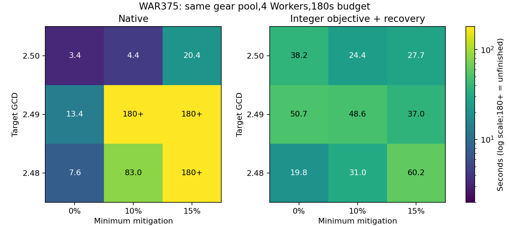

# 全局算法稳定性与正确性验证

> 当前决定（2026-10-30）：HiGHS 已退出当前求解、验证和基准流程，仅作为[未来可选项](optimizer-highs-future-option.md)归档。下文接入状态、命令与测量属于历史研究记录。

后续：[独立精确证书实现](optimizer-strict-proof.md)已加入实验入口，只有独立核验通过才标最优；旧耗时仅代表候选搜索阶段。完整画家、战士追加30秒证明仍未证完，尚不采用或部署严格模式。

2026-10-30。本轮两种算法分别统一覆盖相同测试矩阵，不按职业、目标或运行时间选择算法。网页默认行为未改，未部署。新算法仍属实验实现。

## 正确性结论的边界

当前不能给出“所有合法用户输入都必定全局最优”的保证。应区分以下三层：

1. **方案是否合法、评分是否一致**：候选、装备槽位、唯一戒指、魔晶石、食物、GCD、坚韧和真实评分可重算。整数模型还逐行检查返回解是否满足整数约束。此检查不能证明没有遗漏更好的方案。
2. **限定问题内确实最优**：独立枚举原始候选及全部合法魔晶石组合，不调用原生剪枝；用Python `Fraction`评分，得到有理数最优值，再检查两种算法返回方案的有理数分数是否与它完全相等。
3. **任意完整输入全局最优**：仍依赖候选适配完整、模型准确、误差范围保守和HiGHS最优性／不可行性判定可靠。没有对其整个分支定界过程作独立精确证书验证。两种算法分数一致也不能代替这项证明。

整数目标误差恢复有条件性的数学依据：每个伤害因子恰选一个档位，取整误差每组最多0.5；真正更优的分数必然落在保守整数目标范围内。逐个排除已检查因子组合并搜索这个范围，能消除单纯目标取整造成的错序。工程实现额外使用0.01的浮点余量，尚未以区间算术完成全域误差证明；不能将这点和浮点整数规划求解器一起称为严格形式化保证。

## 新增独立枚举器

实现：`scripts/experiments/optimizer-raw-oracle.py`与`test-optimizer-integer-oracle.mjs`。独立枚举器不导入原生候选生成、支配筛选、属性树或评分函数；装备与魔晶石从原始输入直接展开。返回方案由另一遍独立重算校验，最终目标以有理数完全相等为准，不仅依赖浮点容差。

4096个确定性生成输入、193846个原始合法装备／食物分配参与检查。覆盖物理、法系、坦克、蓝魔法师武器与智力耦合、百分比与固定食物、同步、魔晶石上限、唯一及非唯一戒指、锁定、排除、三种暴击偏好、最低坚韧和减伤折算、全局候选下界。共3492个有可用解输入，两种算法6984个返回方案的有理数评分均等于枚举最优；604个无可用解输入两者均返回无解。

这些是缩小后的组合问题：三个部位，其中戒指选两件；每部位少量生成装备、少量魔晶石选项。它们能提供独立正确性对照，不能替代完整真实装备池的性能测试或全输入证明。固定随机种子只使复现确定，不表示对所有输入均匀抽样。

额外去掉测试输入预填的暴击范围，实际调用原生自动范围解析并与枚举端点对照：2430个可行高／低暴击输入范围完全一致，300个输入正确判定没有可行范围。模型使用实际解析出的范围，原生优化器也从未解析状态开始求解；返回方案仍全部达到有理数枚举最优。

## 本轮发现并修复的求解错误

扩大到4096输入时，旧排除约束在id1988触发HiGHS求解错误，全新实例可复现。日志显示，第二次求解时presolve将问题化为空模型并宣称Optimal，但重构解违反一条约束，HiGHS自身随后报告Solve error，因此实验并未返回这个无效解。关闭presolve的诊断版本可以正确完成，但未据此引入条件开关。

原写法是对已选因子档位求和，要求`sum(selected) <= G-1`。现对所有输入统一改成`sum(unselected) >= 1`。在每组恰选一档的约束下，两者数学等价；当没有其他档位时，所有可行解的评分相同，首个已验证最优解即可结束。没有根据职业或案例选择不同算法。

新增固定fixture `integer-presolve-score-exclusion-regression.json`。修复前错误输出、完整输入、模型数据及诊断日志保留；4096例使用新写法和精确返回方案校验重新跑完。该写法会影响求解器搜索行为，因此本轮完整性能矩阵使用新的冻结版本，不把上一轮数字当成本轮结果。

## 稳定性实验设计

测试前固定矩阵：战士375，同一装备池的GCD2.50／2.49／2.48与最低减伤0／10%／15%的3×3组合；画家375，同一装备池的GCD2.50／2.49／2.48；武僧605，同一装备池的GCD1.95／1.94／1.93，不限暴击；以及骑士605／2.45／最低10%。总计16个不同输入，每个分别跑原生与新模型。

在矩阵末尾再重复普通战士2.50与武僧1.94的完全相同输入，每种算法各一次。总计36次完整浏览器尝试。每对算法的运行先后顺序由固定随机种子交错，全部串行，4 Workers，新浏览器，固定180秒预算。计时包含规划、Worker初始化和所有食物分片，排除构建及浏览器启动；先完成正确性回归，再开始计时。

比较完成率、截止180秒的耗时分布、相邻参数变化和相同输入重复的差异。超时按右删失处理：知道运行至少180秒，不知道真正完成时间；不使用180秒冒充完整耗时。预算截断平均耗时`mean(min(T,180s))`可描述“每次最多等180秒”的使用策略，不能称为真实平均完成时间。若高分位落入超时区域，只报告下界。

本矩阵属于有目的选择的压力测试，不代表所有用户请求的自然分布。每个重复输入只有两次，本轮不能据此给出可靠的方差或尾部概率置信区间。判断“新算法更稳定”须限定到已测试矩阵和时间预算。

## 本轮实测结果

36次浏览器尝试中，31次完成、5次达到180秒预算；16个不同输入的主要对照中，新算法16例全部完成，原生11例完成。双方完成的11个主要配对及2个重复配对目标值一致；所有完整返回结果通过独立重算。新算法骑士2.45／10%与武僧1.93还分别恢复已知参考值21.165158132308274与27.16929816050764。

| 指标：16个主要输入等权 | 原生 | 新算法 |
| --- | ---: | ---: |
| 180秒内完成 | 11/16 | 16/16 |
| 达到180秒预算 | 5/16 | 0/16 |
| 样本中位耗时 | 26.82秒 | 37.64秒 |
| 最慢观测／下界 | ≥180秒 | 115.85秒 |
| 每次最多等待180秒的平均时间 | 70.08秒 | 46.53秒 |

这批输入中，新算法减少了预算内未完成的任务，截断平均等待时间下降33.6%，但中位耗时上升。它改善了本矩阵的长尾，不能称为所有任务更快，也不能称整体耗时减半。5个未完成任务的真实完成耗时未知，未用180秒冒充它们的完成时间。

| 输入 | 原生秒 | 新算法秒 |
| --- | ---: | ---: |
| WAR-2.50-TEN0.00 | 3.37 | 38.24 |
| WAR-2.50-TEN0.10 | 4.40 | 24.41 |
| WAR-2.50-TEN0.15 | 20.38 | 27.71 |
| WAR-2.49-TEN0.00 | 13.36 | 50.72 |
| WAR-2.49-TEN0.10 | ≥180，未完成 | 48.59 |
| WAR-2.49-TEN0.15 | ≥180，未完成 | 37.05 |
| WAR-2.48-TEN0.00 | 7.61 | 19.77 |
| WAR-2.48-TEN0.10 | 83.01 | 31.04 |
| WAR-2.48-TEN0.15 | ≥180，未完成 | 60.21 |
| PCT-2.50 | 1.97 | 9.19 |
| PCT-2.49 | 4.10 | 12.22 |
| PCT-2.48 | 4.13 | 19.28 |
| MNK-1.95 | 33.26 | 64.12 |
| MNK-1.94 | 45.65 | 96.02 |
| MNK-1.93 | ≥180，未完成 | 115.85 |
| PLD-2.45-TEN0.10 | ≥180，未完成 | 90.09 |

WAR为战士375，PCT为画家375，MNK为武僧605，PLD为骑士605；TEN为最低坚韧减伤比例。完整输入与哈希均归档。

### 相同输入重复与参数变化

| 输入／算法 | 第一次秒 | 第二次秒 |
| --- | ---: | ---: |
| WAR-2.50-TEN0.00／native | 3.37 | 2.96 |
| WAR-2.50-TEN0.00／integer | 38.24 | 38.86 |
| MNK-1.94／native | 45.65 | 45.30 |
| MNK-1.94／integer | 96.02 | 97.38 |

两次重复未见数量级漂移；每输入每算法仅两次，不足以证明不存在偶发长尾。与之相比，原生战士最低减伤10%，GCD从2.50改为2.49时，从4.40秒变为180秒未完成；新算法从24.41秒变为48.59秒。战士网格中原生3.37秒至≥180秒，新算法19.77至约60.2秒。武僧三个相邻GCD的新算法约64／96／116秒，原生约33／46／≥180秒；画家两种算法均未出现极端长尾，新算法均更慢。

这支持“当前压力矩阵中新算法对输入变化的极端耗时更可控”，并不证明任意输入稳定，也没有确定可用于条件启用的优势区间。本轮没有条件路由或限时切换，不据此启用部分案例。



## 数据与复现

[可机读记录](benchmarks/optimizer-stability-correctness-20261030.json)与[原始归档](benchmarks/optimizer-stability-correctness-20261030.json.gz)包含36次输出、输入、冻结源码指纹、独立枚举语料与返回方案、修复前错误模型和日志，以及调度脚本。

```sh
node scripts/experiments/test-optimizer-integer-oracle.mjs --count 4096
node scripts/experiments/test-optimizer-integer.mjs --recovery --real-subsets 128
```

最终检查：lint、8个优化器测试文件、相关JS／Python脚本语法、生产构建与`git diff --check`通过。归档SHA、冻结源码及后续范围验证器源码、36次原始输出和文档链接已核对。所有测试、归档与绘图均在性能计时之外运行。
